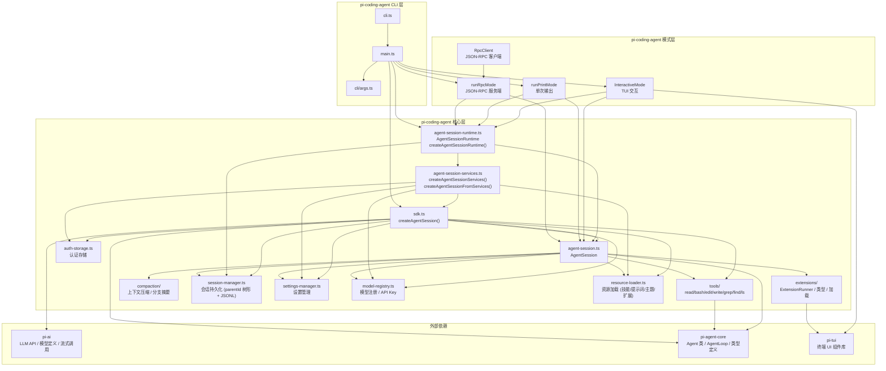

# 目录

[TOC]


# Pi Ai 源码分析

重点看如下几个源码文件就行：
- index.ts
- types.ts
- providers/all.ts
- providers/deepseek.ts，看一个模型的示例即可
- api/openai-completions.ts

可以结合下面两个官方项目文档，了解pi-ai的使用方式和设计思路：
- [pi-ai:README.md](../packages/ai/README.md): 使用方式
- [pi-agent-core:docs/models.md](../packages/agent/docs/models.md): 设计思路

另外，pi-ai的models使用在 v0.80.0 版本经历了一次 Breaking Changes，
参考文档 [pi-ai:CHANGELOG.md](../packages/ai/CHANGELOG.md#v0.80.0-breaking-changes).

------------------------------------------------------------
# Pi Agent Core 源码分析

> 分析版本: v0.80.3 | 包名: `@earendil-works/pi-agent-core`

---

## 一、入口文件及其执行链条

### 1.1 入口文件

| 入口 | 文件 | 用途 |
|------|------|------|
| 主入口 | `src/index.ts` | 重新导出所有公共 API |
| Node.js 入口 | `src/node.ts` | 主入口 + `NodeExecutionEnv`（Node.js 文件系统和 Shell 实现） |

`src/index.ts` 的导出结构：

```
src/index.ts
├── agent.ts          → Agent 类（有状态的高级封装）
├── agent-loop.ts     → 低级 Agent 循环函数（无状态）
├── harness/          → AgentHarness（会话管理、压缩、钩子系统）
│   ├── agent-harness.ts
│   ├── compaction/   → 上下文压缩 & 分支摘要
│   ├── session/      → 会话持久化（JSONL / 内存）
│   ├── messages.ts   → AgentMessage ↔ LLM Message 转换
│   ├── system-prompt.ts → 系统提示词格式化（含 Skills）
│   ├── skills.ts     → Skill 加载
│   ├── prompt-templates.ts → Prompt 模板加载
│   ├── env/nodejs.ts → Node.js ExecutionEnv 实现
│   └── utils/        → shell-output, truncate 工具
├── proxy.ts          → 代理流函数（通过服务器路由 LLM 调用）
└── types.ts          → 所有类型定义
```

### 1.2 执行链条

```
用户调用
  │
  ├─► Agent.prompt(text)                    [agent.ts]
  │     └─► runAgentLoop(messages, ctx, config, emit, signal, streamFn)  [agent-loop.ts]
  │           └─► runLoop(ctx, newMessages, config, signal, emit, streamFn)
  │                 │
  │                 │  ┌── 外层循环: 处理 follow-up 消息 ──────────────────┐
  │                 │  │                                                  │
  │                 │  │  ┌── 内层循环: 处理 tool calls + steering ────┐   │
  │                 │  │  │                                           │   │
  │                 │  │  │  1. 注入 pending steering/follow-up 消息   │   │
  │                 │  │  │  2. streamAssistantResponse() → LLM 调用   │   │
  │                 │  │  │  3. executeToolCalls() → 工具执行          │   │
  │                 │  │  │     ├─ sequential: 逐个执行                │   │
  │                 │  │  │     └─ parallel: 并发执行                  │   │
  │                 │  │  │  4. emit turn_end                         │   │
  │                 │  │  │  5. prepareNextTurn() → 刷新会话状态       │   │
  │                 │  │  │  6. shouldStopAfterTurn()? → 退出          │  │
  │                 │  │  │  7. getSteeringMessages() → 下一轮         │  │
  │                 │  │  └────────────────────────────────────────────┘  │
  │                 │  │                                                  │
  │                 │  │  8. getFollowUpMessages() → 有则继续外层循环       │
  │                 │  └──────────────────────────────────────────────────┘
  │                 │
  │                 └─► emit agent_end
  │
  └─► AgentHarness.prompt(text)             [harness/agent-harness.ts]
        └─► createTurnState() → 从 Session 构建 Turn Snapshot
        └─► executeTurn() → 直接调用 runAgentLoop()（不经过 Agent 类）
              └─► handleAgentEvent() → 事件处理 + 会话持久化
```

---

## 二、整体设计思路和架构

### 2.1 分层架构

`AgentHarness` 和 `Agent` 是**两条并行的上层路径**，它们都基于底层的 `agent-loop.ts` 和 `pi-ai`：

```
┌──────────────────────────┐  ┌──────────────────────────────┐
│       AgentHarness       │  │           Agent              │
│  会话管理 · 压缩 · 钩子   │  │  状态封装 · 事件订阅 · 队列    │
│  (harness/agent-harness) │  │  (agent.ts)                  │
│  直接调用 runAgentLoop()  │  │  调用 runAgentLoop()         │
└──────────┬───────────────┘  └──────────────┬───────────────┘
           │                                 │
           └───────────┬─────────────────────┘
                       │
           ┌───────────▼────────────────────────────┐
           │       低级 Agent 循环 (无状态)          │
           │  runAgentLoop / runLoop                │
           │  streamAssistantResponse               │
           │  executeToolCalls (sequential|parallel)│
           │  (agent-loop.ts)                       │
           ├────────────────────────────────────────┤
           │          pi-ai (LLM API)               │
           │  streamSimple · Model · Message        │
           │  (packages/ai)                         │
           └────────────────────────────────────────┘
```

### 2.2 核心设计原则

1. **关注点分离**：低级循环（`agent-loop.ts`）是无状态的纯函数。`Agent` 类和 `AgentHarness` 是两条独立的上层路径——`Agent` 类在循环之上添加有状态封装和事件系统，`AgentHarness` 则在循环之上添加会话持久化、钩子、压缩等基础设施。`AgentHarness` 不依赖 `Agent` 类，而是直接调用 `runAgentLoop()`。

2. **AgentMessage 抽象**：所有消息使用 `AgentMessage`（`Message | CustomAgentMessages[keyof CustomAgentMessages]`），在 LLM 调用边界通过 `convertToLlm()` 转换为标准 `Message[]`。应用可通过 TypeScript 声明合并扩展自定义消息类型。

3. **事件驱动**：Agent 循环通过 `AgentEvent` 联合类型发出生命周期事件（`agent_start/end`、`turn_start/end`、`message_start/update/end`、`tool_execution_start/update/end`），UI 层通过 `subscribe()` 监听。

4. **消息队列系统**：支持两种队列
   - **Steering Queue**：在当前 assistant turn 完成后立即注入（用于中途干预）
   - **Follow-up Queue**：仅在 Agent 即将停止时注入（用于追加任务）
   - 每种队列支持 `"all"`（一次全部排出）和 `"one-at-a-time"`（每次排出一个）模式

5. **工具执行策略**：
   - `"sequential"`：逐个准备 → 执行 → 完成
   - `"parallel"`：顺序准备，然后并发执行，按完成顺序发出 `tool_execution_end`，按 assistant 源码顺序发出 tool-result 消息

---

## 三、基本 Agent 循环实现逻辑

### 3.1 涉及的核心源码文件

| 文件 | 职责 |
|------|------|
| `src/agent-loop.ts` | 低级循环：`runAgentLoop`、`runAgentLoopContinue`、`runLoop`、`streamAssistantResponse`、`executeToolCalls` |
| `src/agent.ts` | `Agent` 类：状态管理、生命周期、消息队列、事件分发 |
| `src/types.ts` | 类型定义：`AgentContext`、`AgentLoopConfig`、`AgentEvent`、`AgentTool`、`StreamFn` 等 |

### 3.2 循环详细逻辑

#### 3.2.1 入口：`runAgentLoop`

agent-loop.ts:95-115

```typescript
async function runAgentLoop(prompts, context, config, emit, signal, streamFn) {
    // 1. 将 prompts 追加到 context.messages
    // 2. emit agent_start → turn_start → message_start/end (每个 prompt)
    // 3. 调用 runLoop()
}
```

#### 3.2.2 核心：`runLoop`

agent-loop.ts:148-270

双层循环结构：

**外层循环** — 处理 follow-up 消息：
- 当内层循环结束（无更多 tool calls 且无 steering 消息）时
- 检查 `getFollowUpMessages()`，有则重新进入内层循环
- 无则退出，emit `agent_end`

**内层循环** — 处理 tool calls + steering：
1. **注入 pending 消息**：将 steering/follow-up 队列中的消息注入 context
2. **`streamAssistantResponse()`**：调用 LLM 获取 assistant 响应
   - 应用 `transformContext`（AgentMessage 级别转换，如上下文窗口管理）
   - 调用 `convertToLlm`（AgentMessage → LLM Message）
   - 通过 `streamFn`（默认 `streamSimple`）发起 LLM 请求
   - 流式处理响应事件（`text_start/delta/end`、`thinking_*`、`toolcall_*`）
   - 返回最终的 `AssistantMessage`
3. **`executeToolCalls()`**：执行 assistant 消息中的 tool calls
   - 检查是否有工具标记为 `sequential` 模式
   - 根据 `toolExecution` 配置选择 sequential 或 parallel 执行
   - 每个 tool call 经历：`prepareToolCall` → `beforeToolCall` 钩子 → `execute` → `afterToolCall` 钩子 → `finalize`
4. **emit `turn_end`**
5. **`prepareNextTurn()`**：允许更新 context/model/thinkingLevel
6. **`shouldStopAfterTurn()`**：检查是否应停止
7. **`getSteeringMessages()`**：获取 steering 消息，有则继续内层循环

#### 3.2.3 工具执行流程

```
prepareToolCall()
  ├─ 查找 tool 定义
  ├─ prepareArguments() — 参数兼容转换
  ├─ validateToolArguments() — schema 验证
  ├─ beforeToolCall() 钩子 — 可 block 工具执行
  └─ 返回 PreparedToolCall 或 ImmediateToolCallOutcome

executePreparedToolCall()
  ├─ tool.execute(toolCallId, args, signal, onUpdate)
  └─ onUpdate → emit tool_execution_update

finalizeExecutedToolCall()
  ├─ afterToolCall() 钩子 — 可覆盖 content/details/isError/terminate
  └─ 返回 FinalizedToolCallOutcome

emitToolExecutionEnd() → createToolResultMessage() → emitToolResultMessage()
```

#### 3.2.4 关键配置项 (`AgentLoopConfig`)

| 配置 | 说明 |
|------|------|
| `convertToLlm` | AgentMessage[] → Message[] 转换（必须） |
| `transformContext` | LLM 调用前的 AgentMessage 级别转换（可选，如上下文裁剪） |
| `getApiKey` | 动态 API key 解析（支持过期 token 刷新） |
| `beforeToolCall` | 工具执行前钩子，可 block |
| `afterToolCall` | 工具执行后钩子，可覆盖结果 |
| `prepareNextTurn` | 每轮结束后更新 context/model/thinkingLevel |
| `shouldStopAfterTurn` | 每轮结束后判断是否应停止当前对话 |
| `getSteeringMessages` | 获取中途 steering 消息 |
| `getFollowUpMessages` | 获取 follow-up 消息 |
| `toolExecution` | `"sequential"` 或 `"parallel"` |

---

## 四、Agent Harness 工程实现

> [设计文档](../packages/agent/docs/agent-harness.md): `packages/agent/docs/agent-harness.md`

### 4.1 与 Agent 类的关系

**AgentHarness 不依赖 Agent 类**。它直接调用 `agent-loop.ts` 中的 `runAgentLoop()` 函数。这与 `Agent` 类形成两条平行的上层路径，各自基于底层循环构建不同的抽象。

`Agent` 类面向有状态封装（事件订阅、消息队列、state 管理），`AgentHarness` 面向会话持久化、钩子系统、上下文压缩等基础设施。

### 4.2 核心源码文件概览

| 文件 | 职责 |
|------|------|
| `src/harness/agent-harness.ts` | `AgentHarness` 主类：会话管理、钩子系统、turn 执行 |
| `src/harness/types.ts` | Harness 类型：`ExecutionEnv`、`FileSystem`、`Shell`、`Session`、事件类型、错误类型 |
| `src/harness/session/session.ts` | `Session` 类：会话树管理、上下文构建 |
| `src/harness/session/jsonl-repo.ts` | JSONL 文件持久化的 Session 仓库 |
| `src/harness/session/jsonl-storage.ts` | JSONL 存储后端 |
| `src/harness/session/memory-repo.ts` | 内存 Session 仓库（测试用） |
| `src/harness/session/memory-storage.ts` | 内存存储后端 |
| `src/harness/session/repo-utils.ts` | 仓库工具函数 |
| `src/harness/session/uuid.ts` | UUID v7 生成 |
| `src/harness/compaction/compaction.ts` | 上下文压缩：token 估算、cut point 查找、摘要生成 |
| `src/harness/compaction/branch-summarization.ts` | 分支摘要：树导航时的分支变更摘要 |
| `src/harness/compaction/utils.ts` | 压缩工具：文件操作提取、对话序列化 |
| `src/harness/messages.ts` | 消息转换：`convertToLlm`、自定义消息类型 |
| `src/harness/system-prompt.ts` | 系统提示词格式化（含 Skills XML 块） |
| `src/harness/skills.ts` | Skill 加载（从目录递归加载 `SKILL.md`） |
| `src/harness/prompt-templates.ts` | Prompt 模板加载（从 `.md` 文件） |
| `src/harness/env/nodejs.ts` | Node.js `ExecutionEnv` 实现 |
| `src/harness/utils/shell-output.ts` | Shell 输出处理 |
| `src/harness/utils/truncate.ts` | 文本截断工具 |

### 4.3 状态模型 (State Model)

设计文档将 AgentHarness 的状态分为**四类**，这是理解其设计的核心：

| 类别 | 说明 | 生命周期 |
|------|------|---------|
| **Harness Config** | 最新运行时配置（model、thinkingLevel、tools、activeToolNames、resources、streamOptions、systemPrompt）。getter 返回最新值，不是 in-flight 快照。setter 立即更新，影响下一轮 turn snapshot。 | 持久的，跨 turn |
| **Turn Snapshot** | 每轮 LLM 调用时由 `createTurnState()` 创建的快照。包含：持久化 session messages、解析后的 resources、systemPrompt、model、thinkingLevel、activeTools、streamOptions、sessionId。该轮所有逻辑使用同一快照。 | 每轮新建 |
| **Session** | 仅持久化的条目（通过 `SessionStorage` 存储）。不包含 pending writes。读取返回已持久化状态。 | 持久化 |
| **Pending Session Writes** | busy 期间排队的 session 写入。基于 session-entry 形状但无生成字段（`id`、`parentId`、`timestamp`）。在 save point 或 operation settlement 时刷新。 | 排队，随后刷新 |

### 4.4 操作阶段 (Operation Phases)

```typescript
type AgentHarnessPhase = "idle" | "turn" | "compaction" | "branch_summary" | "retry";
```

**结构性操作**（需要 `phase === "idle"`，否则抛出 `AgentHarnessError("busy")`）：
- `prompt()`、`skill()`、`promptFromTemplate()`
- `compact()`、`navigateTree()`

**Turn 期间允许的操作**：
- `steer()`、`followUp()`、`nextTurn()`、`abort()`
- 运行时 config setter（`setModel()`、`setThinkingLevel()`、`setTools()` 等）

### 4.5 AgentHarness 架构

```
AgentHarness
├── 状态模型
│   ├── Harness Config — 最新运行时配置，getter/setter 立即生效
│   ├── Turn Snapshot — createTurnState() 创建，每轮快照
│   ├── Session — 仅持久化条目，不包含 pending writes
│   └── Pending Session Writes — busy 期间排队，save point 刷新
│
├── 会话管理 (Session)
│   ├── 树形会话结构 (parentId 链表)
│   ├── 多种条目类型: message, model_change, thinking_level_change,
│   │   active_tools_change, compaction, branch_summary, custom, label, leaf
│   ├── 持久化后端: JSONL 文件 或 内存
│   └── buildContext() → 从当前分支重建 AgentMessage[]
│
├── 上下文压缩 (Compaction)
│   ├── shouldCompact() — 判断是否需要压缩
│   ├── prepareCompaction() — 准备压缩（找 cut point）
│   ├── compact() — 调用 LLM 生成摘要
│   └── 文件操作追踪 (readFiles / modifiedFiles)
│
├── 分支导航 (Branch Summarization)
│   ├── navigateTree() — 在会话树中跳转
│   ├── collectEntriesForBranchSummary() — 收集需要摘要的条目
│   └── generateBranchSummary() — 生成分支变更摘要
│
├── 钩子系统 (Hooks)
│   ├── subscribe() — 通配符订阅，接收所有事件（observational）
│   ├── on() — 按事件类型注册，可返回结果（mutation hooks）
│   ├── before_agent_start — 修改 prompt / systemPrompt
│   ├── context — 修改发送给 LLM 的消息
│   ├── before_provider_request — 修改 stream options（支持链式 patch）
│   ├── before_provider_payload — 修改请求 payload
│   ├── after_provider_response — 观察响应
│   ├── tool_call — 可 block 工具调用
│   ├── tool_result — 可覆盖结果（content/details/isError/terminate）
│   ├── session_before_compact — 压缩前拦截（可取消或提供自定义摘要）
│   ├── session_compact — 压缩后通知
│   ├── session_before_tree — 树导航前拦截（可取消）
│   └── session_tree — 树导航后通知
│
├── 资源管理
│   ├── Skills — 通过 setResources() 注入，system prompt 回调中格式化
│   └── Prompt Templates — 通过 setResources() 注入，promptFromTemplate() 使用
│
└── 执行环境抽象 (ExecutionEnv)
    ├── FileSystem — 平台无关的文件操作
    └── Shell — 平台无关的命令执行
```

### 4.6 AgentHarness 执行流程

```
AgentHarness.prompt(text)
  │
  ├─ 1. 检查 phase === "idle"（否则抛出 "busy"）
  ├─ 2. 设置 phase = "turn"
  ├─ 3. createTurnState() — 创建 Turn Snapshot
  │     ├─ session.buildContext() → 从会话树重建消息（含 compaction 处理）
  │     ├─ getResources() → 获取 skills / promptTemplates（浅拷贝）
  │     ├─ 解析 activeTools（从 activeToolNames 映射到实际 tool 对象）
  │     ├─ 构建 systemPrompt：
  │     │   ├─ 如果是字符串 → 直接使用
  │     │   └─ 如果是回调 → 调用并传入 { env, session, model, thinkingLevel, activeTools, resources }
  │     └─ 返回 AgentHarnessTurnState（包含 messages, resources, streamOptions, sessionId, systemPrompt, model, thinkingLevel, tools, activeTools）
  │
  ├─ 4. executeTurn(turnState, text)
  │     ├─ 处理 nextTurnQueue 中的排队消息（插入到用户消息之前）
  │     ├─ emitHook("before_agent_start") → 可修改 messages[] 和 systemPrompt
  │     ├─ 创建 AbortController（赋值给 runAbortController）
  │     ├─ 直接调用 runAgentLoop()（不经过 Agent 类）
  │     │     ├─ createContext(turnState, overrideSystemPrompt?) → AgentContext
  │     │     ├─ createLoopConfig(getTurnState, setTurnState) → AgentLoopConfig
  │     │     │     ├─ convertToLlm: 来自 harness/messages.ts
  │     │     │     ├─ transformContext → emitHook("context")
  │     │     │     ├─ beforeToolCall → emitHook("tool_call")
  │     │     │     ├─ afterToolCall → emitHook("tool_result")
  │     │     │     ├─ prepareNextTurn → flushPendingSessionWrites() + createTurnState()
  │     │     │     │     └─ 创建新的 Turn Snapshot，更新 activeTurnState
  │     │     │     ├─ getSteeringMessages → drainQueuedMessages(steerQueue, steeringQueueMode)
  │     │     │     │     └─ 支持 "all" 或 "one-at-a-time" 排出模式
  │     │     │     │     └─ emitQueueUpdate() 失败时回滚已排出的消息
  │     │     │     └─ getFollowUpMessages → drainQueuedMessages(followUpQueue, followUpQueueMode)
  │     │     ├─ handleAgentEvent(event, signal) → 事件处理 + 会话持久化
  │     │     │     ├─ message_end → session.appendMessage() + emitAny()
  │     │     │     ├─ turn_end → emitAny() + flushPendingSessionWrites() + emitOwn("save_point")
  │     │     │     └─ agent_end → flushPendingSessionWrites() + phase="idle" + emitAny() + emitOwn("settled")
  │     │     └─ createStreamFn(getTurnState) → 包装 models.streamSimple
  │     │           ├─ emitBeforeProviderRequest(model, sessionId, streamOptions)
  │     │           │     └─ 链式调用多个 before_provider_request 钩子，合并 streamOptions patch
  │     │           ├─ onPayload → emitBeforeProviderPayload(model, payload)
  │     │           └─ onResponse → emitOwn("after_provider_response")
  │     │
  │     └─ 从 newMessages 中提取最后一个 AssistantMessage 返回
  │
  └─ 5. finishRunPromise() → runPromise 变为 undefined
```

### 4.7 Save Points（保存点）

Save point 发生在 assistant turn 及其 tool-result 消息完成后（`turn_end` 事件处理中）：

1. 先通知订阅者（`emitAny`），然后刷新 pending session writes
2. 如果循环继续，`prepareNextTurn` 回调会：
   - 刷新 pending session writes
   - 调用 `createTurnState()` 创建新的 Turn Snapshot
   - 更新 `activeTurnState`，使下一轮 LLM 调用使用新配置
3. 发出 `save_point` 事件（含 `hadPendingMutations` 标志）

这确保了 model、thinkingLevel、tools、resources、streamOptions 的变更在 turn 期间不会影响当前 in-flight 请求，但会在下一轮生效。

### 4.8 Abort 语义

- `abort()` 在 turn 期间允许，不在 idle 时使用
- 调用 `runAbortController.abort()` 取消底层循环
- **清除** steering 和 followUp 队列
- **不清除** `nextTurnQueue`（消息在下一次用户发起的 turn 中插入到用户消息之前）
- **不丢弃** pending session writes（在下一个 save point 或 `agent_end` 时刷新）
- 返回 `{ clearedSteer, clearedFollowUp }`

### 4.9 会话模型

会话采用**树形结构**，每个条目通过 `parentId` 链接到父节点：

```
SessionTreeEntry 类型:
├── message           — 对话消息
├── model_change      — 模型切换记录
├── thinking_level_change — 思考级别变更
├── active_tools_change   — 活跃工具集变更
├── compaction        — 上下文压缩摘要
├── branch_summary    — 分支跳转摘要
├── custom            — 自定义条目
├── custom_message    — 自定义消息（可控制是否显示）
├── label             — 标签（用于 UI 书签）
├── session_info      — 会话名称
└── leaf              — 当前分支叶子指针（持久化为 entry，非纯内存游标）
```

`buildContext()` 从当前 leaf 沿 `parentId` 链回溯到根，重建 `AgentMessage[]`。遇到 `compaction` 条目时，只保留摘要消息和 `firstKeptEntryId` 之后的消息。

`setLeafId()` 不是纯内存操作——它持久化一条 `leaf` entry，其 `targetId` 为当前活跃叶子或 `null`（根节点）。重新打开存储时必须从最新的 leaf-affecting entry 重建当前叶子。

### 4.10 上下文压缩 (Compaction)

压缩流程：

1. **`shouldCompact()`**：当 `contextTokens > contextWindow - reserveTokens` 时触发
2. **`prepareCompaction()`**：从会话条目中找到合适的 cut point（在 user/assistant 消息边界）
3. **`compact()`**：
   - 序列化被压缩的对话
   - 提取文件操作（readFiles / modifiedFiles）
   - 调用 LLM 生成结构化摘要
4. 摘要作为 `compaction` 条目持久化，后续 `buildContext()` 自动使用

### 4.11 错误处理

- **低层能力**（`ExecutionEnv`、文件系统、Shell、资源加载、compaction 辅助函数）：使用 `Result<T, E>` 模式，不抛异常
- **高层变更/编排 API**（`Session`、`AgentHarness`）：reject/throw，不返回可忽略的 bare result
- 公共 harness 失败被规范化为 `AgentHarnessError`；子系统错误保留为 `cause`
- 钩子/订阅者失败在 commit 之后：状态变更不回滚，公共方法 reject 并带 `AgentHarnessError("hook")`
- Queue drain 失败时消息回滚（`drainQueuedMessages` 在 `emitQueueUpdate` 失败后 `unshift` 回去）

### 4.12 关键设计特点

1. **平台无关的执行环境**：`ExecutionEnv` 接口抽象了文件系统和 Shell，`NodeExecutionEnv` 是 Node.js 实现。这使得 harness 可以在浏览器、沙箱等不同环境中运行。

2. **Result 类型**：所有 I/O 操作返回 `Result<T, E>`（`{ ok: true, value } | { ok: false, error }`），不抛异常。这确保了 harness 在文件系统错误等场景下的健壮性。

3. **延迟会话写入**：在 turn 执行期间，会话写入被缓存在 `pendingSessionWrites` 队列中，在 `turn_end` 时批量刷新。这保证了会话状态的一致性。

4. **泛型扩展**：`AgentHarness<TSkill, TPromptTemplate, TTool>` 使用泛型参数，允许应用层使用更具体的 Skill/PromptTemplate/Tool 类型。

5. **钩子链**：多个同类型钩子按注册顺序依次执行，后续钩子可覆盖前一个的结果（如 `before_provider_request` 的 streamOptions 合并，支持 key 级别删除）。

6. **直接调用 runAgentLoop**：AgentHarness 不通过 `Agent` 类，而是直接调用 `agent-loop.ts` 的 `runAgentLoop()`。它自己管理 run 生命周期、abort controller、queue draining、provider stream config、event reduction、session persistence、pending write flushing 和 save-point snapshots。

7. **Config 与 Snapshot 分离**：getter 返回最新 harness config，不是 in-flight 快照。setter 立即更新 config，影响下一次 `createTurnState()`。Turn Snapshot 一旦创建就不可变，保证该轮 LLM 调用的一致性。


## 五、组件细节讨论

### 5.1 Session设计

#### 1. Session 设计思路

Session 子系统是 `AgentHarness` 的持久化基础设施，核心设计遵循以下原则：

（1）**树形会话结构**：

- Session 采用树形结构，每个条目（`SessionTreeEntry`）通过 `parentId` 链接到父节点。
- 当前分支位置通过 `leaf` 条目（`LeafEntry`，含 `targetId`）持久化记录，而非纯内存游标。
- 这意味着重新打开存储时必须从最新的 leaf-affecting entry 重建当前叶子位置。

> 源码里逻辑上它存储的是树形结构的会话条目，但是物理存储（数据结构）上，并没有使用传统的二叉树或者树形数据结构，而是通过一个Map (byId属性) + 数组entries + 每个SessionTreeEntry 内部的 parentID引用机制实现的树形逻辑结构。

（2）**持久化历史消息 + 操作行为** - KEY

树形结构的会话条目 `SessionTreeEntry` 是一个**联合类型**，说明SessionStorage中存储的会话历史记录里，不仅是对话历史Messages，还**包括操作行为记录，这一点和初级Agent仅仅持久化对话历史不一样**。

详细说明见下面的 *SessionStorage 存储分析* 小节。

（3）**三层架构**

Session 子系统分为三层：

```
SessionRepo (管理多个 Session)
    └── Session (对 SessionStorage 的薄封装，提供便捷的 CRUD 方法)
           └── SessionStorage (底层持久化接口，定义实际的存储行为)
```

- `SessionStorage` 是**接口层**，定义了 `getLeafId`、`setLeafId`、`appendEntry`、`getEntry`、`getPathToRoot`、`getEntries` 等底层操作。
- `Session` 是**薄封装层**，在 `SessionStorage` 之上提供 `appendMessage`、`appendModelChange`、`appendCompaction`、`moveTo`、`buildContext` 等语义化方法，本质上是对底层存储接口的 CRUD 封装，不包含复杂业务逻辑。
- `SessionRepo` 是**仓库层**，管理多个 `Session` 实例的生命周期（创建、打开、列表、删除、fork）。

（4）**延迟写入与 save point 机制**

在 `AgentHarness` 的 turn 执行期间，会话写入不直接调用 `Session` 的方法，而是缓存在 `pendingSessionWrites` 队列中。这些写入在 `turn_end`（save point）或 `agent_end`（settlement）时批量刷新到 `Session`。这保证了会话状态的一致性——如果 turn 中途失败，未刷新的写入不会污染持久化状态。

（5）**上下文重建（`buildContext`）**

`buildSessionContext()` 从当前 leaf 沿 `parentId` 链回溯到根，重建 `AgentMessage[]` 和当前上下文状态（`thinkingLevel`、`model`、`activeToolNames`）。遇到 `compaction` 条目时，跳过被压缩的条目，只保留摘要消息和 `firstKeptEntryId` 之后的消息。

（6）**两种存储后端**

内置了如下两种实现，均实现 `SessionStorage` 接口：
- `InMemorySessionStorage`: 测试用
- `JsonlSessionStorage`: 生产用，追加式 JSONL 文件

#### 2. Session 主要功能和使用

| 功能 | 方法 | 说明 |
|------|------|------|
| **上下文重建** | `buildContext()` / `buildSessionContext()` | 从树形结构中重建 `AgentMessage[]` 和当前上下文 |
| 消息追加 | `appendMessage()` | 追加对话消息（user/assistant/tool-result） |
| 配置变更记录 | `appendModelChange()` / `appendThinkingLevelChange()` / `appendActiveToolsChange()` | 持久化模型、思考级别、工具集的变更 |
| 上下文压缩 | `appendCompaction()` | 持久化压缩摘要，包含 `firstKeptEntryId` 用于后续上下文重建时跳过被压缩条目 |
| **分支查询** | `getBranch(fromId?)` | 获取从根到指定（或当前）叶子的完整路径 |
| **分支导航** | `moveTo(entryId, summary?)` | 跳转到会话树中的任意节点，可选附带分支摘要 |
| 分支摘要 | `appendBranchSummary()` | 树导航时自动生成变更摘要 |
| 标签 | `appendLabel()` | 为条目打标签（用于 UI 书签） |
| 自定义条目 | `appendCustomEntry()` / `appendCustomMessageEntry()` | 扩展自定义条目类型 |
| 会话信息 | `appendSessionName()` / `getSessionName()` | 会话名称管理 |
| Fork 支持 | `SessionRepo.fork()` | 从某个会话的指定节点分叉出新的会话实例 |

> 上面的API中，只有 `getBranch()` 和 `buildContext()` 方法比较重型，
> 其他方法都只是简单的 append 一条对应操作类型的记录而已，包括 moveTo() 方法。
> 个人感觉这也是 pi-agent-core Session 系统设计里最出彩的地方之一。

在 `AgentHarness` 执行流程中的使用场景：

- **`createTurnState()`** 时调用 `session.buildContext()` 从持久化状态重建消息上下文
- **`message_end` 事件**时调用 `session.appendMessage()` 持久化消息
- **`turn_end`（save point）** 时刷新 `pendingSessionWrites`（批量写入 model/thinking/tool 变更等）
- **`compact()`** 时调用 `session.appendCompaction()` 持久化压缩摘要
- **`navigateTree()`** 时调用 `session.moveTo()` 跳转分支
- **idle 时的 config setter**（`setModel`、`setThinkingLevel`、`setActiveTools`）直接调用 session 的 append 方法立即持久化

#### 3. SessionStorage 存储分析 - KEY

（1）SessionStorage 中记录的行为是 11 种条目类型的联合，分为以下几类：

- **对话类**（参与 `buildContext` 消息重建）：

| 条目类型         | 记录内容                               | 触发场景                        |
| ---------------- | -------------------------------------- | ------------------------------- |
| `message`        | 对话消息（user/assistant/tool-result） | 每轮 LLM 交互产生的消息         |
| `custom_message` | 自定义消息（可控 `display` 是否展示）  | 应用层注入的系统级消息          |
| `branch_summary` | 分支跳转摘要                           | `navigateTree()` 跳转分支时生成 |

- **配置变更类**（记录运行时状态变更，不产生 LLM 消息）：

| 条目类型                | 记录内容                       | 触发场景                          |
| ----------------------- | ------------------------------ | --------------------------------- |
| `model_change`          | 模型切换（provider + modelId） | `setModel()`                      |
| `thinking_level_change` | 思考级别变更                   | `setThinkingLevel()`              |
| `active_tools_change`   | 活跃工具集变更                 | `setTools()` / `setActiveTools()` |

- **压缩/结构类**：

| 条目类型     | 记录内容                            | 触发场景                   |
| ------------ | ----------------------------------- | -------------------------- |
| `compaction` | 上下文压缩摘要 + `firstKeptEntryId` | `compact()`                |
| `leaf`       | 当前分支叶子指针（`targetId`）      | `setLeafId()` / `moveTo()` |

- **元数据/扩展类**：

| 条目类型       | 记录内容         | 触发场景              |
| -------------- | ---------------- | --------------------- |
| `label`        | 给任意条目打标签 | `appendLabel()`       |
| `custom`       | 自定义数据       | 应用层扩展            |
| `session_info` | 会话名称         | `appendSessionName()` |

关键点：**不是所有条目都参与 `buildContext` 的消息重建**：
- `buildSessionContext()` 函数中，只有 `message`、`custom_message`、`branch_summary` 三种会被提取为 `AgentMessage[]`。
- `model_change`、`thinking_level_change`、`active_tools_change` 仅用于推断当前上下文状态（当前用哪个模型、什么思考级别、哪些工具活跃），`compaction` 用于决定从哪条消息开始保留。

（2）特殊条目

- `LabelEntry`
  - 它不挂在 `parentId` 链上作为树节点，而是通过 `targetId` **指向另一个已存在的条目**。
  - 它的设计意图是**为会话树中的任意节点打书签/标签**，用于 UI 层展示（如 TUI 中的对话分支标记）。

- `LeafEntry`
  - 叶子节点项，它也不参与树结构构建，而是指向另一个Entry。
  - 它**代表的不是当前叶子节点，而是表示一次导航跳转记录**！！！
  - 它和 SessionStorage 的 `leafId` 属性关系密切。

#### 4. Session、SessionStorage、SessionRepo 三者关系

```
┌──────────────────────────────────────────────────────────────┐
│                      SessionRepo                             │
│  (管理多个 Session 的生命周期)                                 │
│  - create(options) → Session                                 │
│  - open(metadata) → Session                                  │
│  - list() → SessionMetadata[]                                │
│  - delete(metadata)                                          │
│  - fork(source, options) → Session                           │
├──────────────────────────────────────────────────────────────┤
│  InMemorySessionRepo          │  JsonlSessionRepo            │
│  (内存 Map，测试用)            │  (JSONL 文件系统，生产用)      │
│  持有 Map<string, Session>    │  sessionsRoot 目录 + 子目录    │
│  通过 InMemorySessionStorage  │  通过 JsonlSessionStorage     │
│  创建 Session                 │  创建 Session                 │
└──────────────┬───────────────┴──────────────┬────────────────┘
               │                              │
               ▼                              ▼
┌──────────────────────────────────────────────────────────────┐
│                        Session                               │
│  (对 SessionStorage 的薄封装，语义化 CRUD 方法)                │
│  - buildContext() → SessionContext                           │
│  - appendMessage / appendModelChange / ...                   │
│  - moveTo(entryId, summary?) — 分支导航                       │
│  - getBranch / getEntry / getLabel / ...                     │
│  内部持有: SessionStorage 实例                                │
├──────────────────────────────────────────────────────────────┤
│  构造函数: constructor(storage: SessionStorage)               │
│  所有方法均委托给 this.storage                                 │
└──────────────┬───────────────────────────────────────────────┘
               │
               ▼
┌──────────────────────────────────────────────────────────────┐
│                    SessionStorage (接口)                     │
│  定义底层持久化操作                                           │
│  - getMetadata() → TMetadata                                 │
│  - getLeafId / setLeafId(leafId)                             │
│  - createEntryId() → string                                  │
│  - appendEntry(entry)                                        │
│  - getEntry(id) → SessionTreeEntry | undefined               │
│  - findEntries(type) → SessionTreeEntry[]                    │
│  - getLabel(id) → string | undefined                         │
│  - getPathToRoot(leafId) → SessionTreeEntry[]                │
│  - getEntries() → SessionTreeEntry[]                         │
├──────────────────────────────────────────────────────────────┤
│  InMemorySessionStorage       │  JsonlSessionStorage         │
│  (内存数组+Map，测试用)        │  (追加式 JSONL 文件，生产用)   │
│  entries: SessionTreeEntry[]  │  filePath: string            │
│  byId: Map<id, entry>         │  entries + byId (内存缓存)    │
│  labelsById: Map<id, label>   │  labelsById: Map<id, label>  │
│  leafId: string | null        │  currentLeafId: string|null  │
└──────────────────────────────────────────────────────────────┘
```

**关键关系总结**：

> `SessionRepo`是留给调用`AgentHarness`的外部系统管理多个会话使用的，
> `AgentHarness`本身不使用`SessionRepo`，而是使用`SessionRepo`里查询获取的`Session`。

1. **`SessionRepo` 是工厂和注册中心**：它负责创建、打开、删除、列出、fork 多个 `Session`。
  - 它拥有 `Session` 实例的所有权。
  - `InMemorySessionRepo` 用 `Map<string, Session>` 管理，`JsonlSessionRepo` 用文件系统目录结构管理。

2. **`Session` 是薄封装**：`Session` 类本身不包含存储逻辑，其构造函数接收一个 `SessionStorage` 实例，所有方法都是对底层 `SessionStorage` 接口的委托调用。
  `Session` 的价值在于提供语义化的方法名（如 `appendMessage` 而非 `appendEntry`）和上下文重建逻辑（`buildContext` → `buildSessionContext`）。

3. **`SessionStorage` 是真正的存储实现**：所有持久化逻辑都在 `SessionStorage` 的实现类中。
  `InMemorySessionStorage` 和 `JsonlSessionStorage` 共享相同的内部数据结构（`entries` 数组、`byId` Map、`labelsById` Map、叶子 ID 追踪），但持久化方式不同——前者存内存，后者追加写入 JSONL 文件。

4. **`toSession()` 是桥接函数**（`repo-utils.ts`）：`const session = new Session(storage)` 的简单工厂，Repo 层通过它把 `SessionStorage` 包装成 `Session`。

5. **`leaf` 条目是关键设计**：`setLeafId()` 不是纯内存操作——它通过 `appendEntry` 持久化一条 `LeafEntry`，其 `targetId` 指向当前活跃叶子或 `null`（根节点）。`leafIdAfterEntry()` 函数定义了规则：普通条目将其 `id` 作为新叶子，`leaf` 条目则使用其 `targetId`。这确保了分支导航在存储重新打开后仍然有效。


-------------------------------------------------------------
# Pi Coding Agent 源码分析

> 包名: `@earendil-works/pi-coding-agent` | CLI 命令: `pi`

---
## 一、整体设计思路

pi-coding-agent 是一个交互式编程 Agent CLI 工具，提供三种运行模式（交互式 TUI、单次 print、JSON-RPC）。

其架构遵循**关注点分离**原则，分为五层（自上而下，上层依赖下层）：

```
┌──────────────────────────────────────────────────────────┐
│                   运行模式 (modes/)                       │
│  InteractiveMode (TUI)  │  PrintMode  │  RpcMode         │
│  使用 pi-tui 渲染界面    │  单次文本输出 │  JSON-RPC 协议   │
│  还有 RpcClient 用于编程式调用                             │
├──────────────────────────────────────────────────────────┤
│        AgentSessionRuntime (agent-session-runtime.ts)    │
│  运行时管理 · Session 切换/分支/fork/replace · 服务生命周期 │
│  createRuntime() 工厂闭包模式 (捕获 CLI 参数)              │
├──────────────────────────────────────────────────────────┤
│  AgentSessionServices (agent-session-services.ts)        │
│  cwd 绑定的基础设施服务工厂:                               │
│  createAgentSessionServices() / createAgentSessionFromServices() │
│  SettingsManager · AuthStorage · ModelRegistry ·         │
│  ResourceLoader · ExtensionRunner                        │
├──────────────────────────────────────────────────────────┤
│              SDK (core/sdk.ts)                           │
│  ★ 核心编排器: createAgentSession()                      │
│  Agent 实例化 · AgentSession 创建 · 工具工厂               │
│  Model 解析 · Auth 管理 · convertToLlm · streamFn 包装    │
├──────────────────────────────────────────────────────────┤
│               AgentSession (core/agent-session.ts)       │
│  会话生命周期 · 事件封装 · 压缩 · Bash执行 · 模型切换       │
│  ExtensionRunner 集成 · 自动重试                          │
│  包装 pi-agent-core 的 Agent 类                           │
├──────────────────────────────────────────────────────────┤
│                pi-agent-core (Agent)                     │
│  Agent 类 · runAgentLoop · AgentMessage · AgentTool      │
│  (packages/agent)                                        │
├──────────────────────────────────────────────────────────┤
│                pi-ai (LLM API)                           │
│  streamSimple · Model · Message                          │
│  (packages/ai)                                           │
└──────────────────────────────────────────────────────────┘
```

> **关键依赖关系**：`agent-session-services.ts` 调用 `sdk.ts` 的 `createAgentSession()`，`sdk.ts` 创建 `Agent`（pi-agent-core）并包装为 `AgentSession`。因此 **SDK 是底层编排器**，`AgentSessionServices` 在其之上提供 cwd 绑定的服务工厂。`main.ts` 通过 `createAgentSessionRuntime()` 工厂闭包将这一切串联起来。

核心设计特点：

1. **模式无关的核心抽象**：`AgentSession` 是所有运行模式共享的核心类，封装了 Agent 生命周期、会话持久化、压缩、Bash 执行等。各模式只负责 I/O 层。各模式通过 `AgentSessionRuntime` 访问 `AgentSession`，`AgentSessionRuntime` 负责会话的创建、替换（切换到不同项目）、fork、分支导航等生命周期管理。

2. **cwd 绑定的服务层**：`AgentSessionServices` 是工作目录绑定的基础设施服务集合。当切换项目 cwd 时（如 `--session` 指定了不同项目的会话），这些服务会随 `createRuntime` 工厂闭包重建。这种设计确保了扩展、技能、设置等资源始终与当前工作目录一致。

3. **自建基础设施（非 AgentHarness）**：pi-coding-agent **没有使用** `pi-agent-core` 中的 `AgentHarness`。它在 `Agent` 类之上构建了自己的并行基础设施——自己的会话管理（`SessionManager`，同样使用 parentId 树形结构 + JSONL 文件）、自己的压缩系统（`core/compaction/`）、自己的消息类型（`core/messages.ts`）、自己的扩展系统（`core/extensions/`）、自己的系统提示词构建器（`core/system-prompt.ts`）。

4. **扩展系统**：通过 `ExtensionRunner` 管理第三方扩展的生命周期，扩展可注册工具、订阅事件、注册 slash 命令、键盘快捷键。扩展系统与 `AgentSession` 深度集成，通过 `agent.beforeToolCall` / `agent.afterToolCall` 钩子拦截工具调用。

5. **工具工厂模式**：所有内置工具（read、bash、edit、write、grep、find、ls）通过工厂函数创建（如 `createReadTool(cwd, options)`），支持自定义 cwd 和配置。`sdk.ts` 导出了工具创建函数供外部 SDK 消费者使用。

6. **会话持久化**：使用 JSONL 文件存储会话历史，底层通过 `parentId` 形成树形结构，支持会话的分支（fork）、摘要（compact）、树导航（navigateTree）。与 `pi-agent-core` 的 Session 系统一样，条目类型不仅包含对话消息，还包含配置变更（model_change、thinking_level_change）、压缩（compaction）、分支摘要（branch_summary）等操作记录。

7. **`createRuntime` 工厂闭包模式**：`main.ts` 中定义了一个 `CreateAgentSessionRuntimeFactory` 类型的闭包，它捕获所有 CLI 参数（`--model`、`--tools`、`--extensions` 等），当需要切换 cwd 时（如 `--session` 指向不同项目），该闭包会被重新调用，以新 cwd 重建所有服务。这是 `AgentSessionRuntime` 的核心设计。

---
## 二、执行模式

| 模式 | 入口文件 | CLI 触发方式 | 说明 |
|------|---------|-------------|------|
| **Interactive** | `modes/interactive/interactive-mode.ts` | 默认（TTY 环境） | 完整的 TUI 交互界面，基于 pi-tui 实现 |
| **Print (text)** | `modes/print-mode.ts` | `pi -p "prompt"` | 单次执行，输出最终 assistant 响应文本 |
| **Print (json)** | `modes/print-mode.ts` | `pi --mode json "prompt"` | 单次执行，输出 JSON 事件流 |
| **RPC** | `modes/rpc/rpc-mode.ts` | `pi --mode rpc` | Headless 模式，通过 stdin/stdout 的 JSON 协议通信 |
| **RPC Client** | `modes/rpc/rpc-client.ts` | 编程式调用 | `RpcClient` 类，封装子进程 spawn + JSON-RPC，提供 `start()`/`prompt()`/`stop()` 等编程接口 |

### 2.1 三种模式对比

| 维度 | **InteractiveMode** | **PrintMode** | **RpcMode** |
|------|---------------------|---------------|-------------|
| **触发条件** | 默认 (TTY 环境) | `-p "prompt"` / `--mode json` / 管道输入 | `--mode rpc` |
| **I/O 方式** | pi-tui 全屏终端 UI | stdout 文本 / JSON 事件流 | stdin/stdout JSON 协议 |
| **生命周期** | 持续运行，等待用户输入 | 单次执行后退出 | 持续运行，等待 JSON 命令 |
| **UI 组件** | 完整 TUI (编辑器/消息列表/状态栏) | 无 UI | 无 UI (通过 JSON 事件通信) |
| **扩展 UI** | 支持对话框/选择器/小组件 | 不支持 | 通过 JSON 协议代理 |
| **会话持久化** | 默认持久化到 JSONL 文件 | 取决于 `--no-session` | 取决于客户端命令 |
| **核心类** | `InteractiveMode` | `runPrintMode()` | `runRpcMode()` + `RpcClient` |

### 2.2 InteractiveMode TUI 结构

`InteractiveMode` 使用 `pi-tui` 构建终端 UI，结构如下：

```
┌──────────────────────────────────────────┐
│  Startup Header (快捷键/扩展/技能列表)     │
├──────────────────────────────────────────┤
│  Messages (用户消息/助手回复/工具调用)     │
│  ├── UserMessageComponent                │
│  ├── AssistantMessageComponent           │
│  ├── ToolExecutionComponent              │
│  ├── BashExecutionComponent              │
│  ├── CompactionSummaryMessageComponent   │
│  └── BranchSummaryMessageComponent       │
├──────────────────────────────────────────┤
│  Editor (输入区域，支持 @自动补全/Tab)     │
│  ├── CustomEditor (默认)                 │
│  └── ExtensionEditorComponent (扩展)     │
├──────────────────────────────────────────┤
│  Footer (cwd/会话名/token/模型/成本)      │
└──────────────────────────────────────────┘
```

它监听 `AgentSession` 事件，将每种事件类型映射到对应的 TUI Component。

---
## 三、整体执行流程

以 `pi -p "hello"` 为例（Print 模式）：

```
cli.ts (Node.js 入口)
  │
  ├─ 设置 process.title / PI_CODING_AGENT 环境变量
  ├─ 禁用 process.emitWarning（减少终端噪音）
  ├─ configureHttpDispatcher() → 配置全局 HTTP 调度器
  └─ main(process.argv.slice(2))

main.ts
  │
  ├─ Phase 1: 参数解析 & 初始化
  │   ├─ parseArgs(args) → 解析 CLI 参数
  │   ├─ resolveAppMode() → 确定模式 (interactive/print/rpc/json)
  │   │   ├─ --mode rpc          → "rpc"
  │   │   ├─ --mode json         → "json"
  │   │   ├─ -p / 非TTY输入      → "print"
  │   │   └─ 默认                → "interactive"
  │   ├─ 特殊命令处理 (--version / --export / pi config / pi update)
  │   ├─ resolveProjectTrusted() → 项目信任检查
  │   ├─ runMigrations(cwd) → 运行数据迁移
  │   └─ createSessionManager() → 创建/恢复/分支会话
  │       ├─ 新建 (默认): SessionManager.create()
  │       ├─ 恢复: SessionManager.continueRecent() / --session
  │       ├─ 分支: SessionManager.forkFrom() / --fork
  │       └─ 内存: SessionManager.inMemory() / --no-session
  │
  ├─ Phase 2: 创建运行时 (核心：createRuntime 工厂闭包)
  │   │
  │   │  ★ main.ts 的核心设计模式：createRuntime 是一个闭包，
  │   │    捕获所有 CLI 参数 (--model, --tools, --extensions 等)，
  │   │    当需要切换 cwd 时 (如 --session 指向不同项目)，
  │   │    该闭包被重新调用，以新 cwd 重建所有服务。
  │   │
  │   ├─ Step 2a: createAgentSessionServices(cwd, agentDir, ...)
  │   │   ├─ SettingsManager.create(cwd, agentDir) → 项目设置
  │   │   ├─ AuthStorage.create(auth.json) → 认证存储
  │   │   ├─ ModelRegistry.create(authStorage, models.json) → 模型注册表
  │   │   └─ DefaultResourceLoader.reload() → 加载扩展资源:
  │   │       ├─ Extensions (TS 模块 → ExtensionRunner)
  │   │       ├─ Skills (SKILL.md)
  │   │       ├─ Prompt Templates (.md)
  │   │       ├─ Themes
  │   │       └─ Context files (AGENTS.md, etc.)
  │   │
  │   ├─ Step 2b: resolveModelScope() → 解析 --models 参数
  │   │
  │   ├─ Step 2c: buildSessionOptions() → 构建 CreateAgentSessionOptions
  │   │   ├─ 解析 --model / --provider / --thinking
  │   │   ├─ 解析 --tools / --no-tools / --exclude-tools
  │   │   └─ 解析 --api-key
  │   │
  │   └─ Step 2d: createAgentSessionFromServices(services, ...)
  │       └─ 内部调用 createAgentSession() [sdk.ts]
  │           ├─ 恢复/选择模型 (从会话恢复 or findInitialModel)
  │           ├─ 创建 Agent 实例 (pi-agent-core)
  │           │   ├─ initialState: { systemPrompt, model, thinkingLevel, tools }
  │           │   ├─ convertToLlm: convertToLlmWithBlockImages
  │           │   ├─ streamFn: 包装 streamSimple (注入 auth/headers/retry)
  │           │   ├─ transformContext: 通过 ExtensionRunner 修改上下文
  │           │   ├─ onPayload / onResponse: 扩展 provider 钩子
  │           │   ├─ steeringMode / followUpMode / transport / thinkingBudgets
  │           │   └─ sessionId: 会话 UUID
  │           └─ 创建 AgentSession(agent, sessionManager, ...)
  │               ├─ 订阅 agent 事件 → _handleAgentEvent (持久化/压缩/扩展转发)
  │               ├─ _installAgentToolHooks() → beforeToolCall/afterToolCall
  │               ├─ _installAgentNextTurnRefresh() → 每轮刷新 system prompt
  │               └─ _buildRuntime() → 构建工具注册表
  │
  ├─ Phase 3: createAgentSessionRuntime(factory)
  │   └─ 创建 AgentSessionRuntime 实例
  │       ├─ 持有 AgentSession 和 AgentSessionServices
  │       ├─ 提供 newSession() / fork() / switchSession() / replace()
  │       └─ setRebindSession() → 模式层重绑定回调
  │
  ├─ Phase 4: 运行对应模式
  │   │
  │   ├─ Print/JSON 模式:
  │   │   ├─ 注册 Signal 处理器 (SIGTERM/SIGHUP)
  │   │   ├─ bindExtensions({ mode, commandContextActions })
  │   │   ├─ prepareInitialMessage() → 处理 @file 和 stdin
  │   │   ├─ session.prompt(message, { images })
  │   │   │     └─ agent.prompt(userMessage) / agent.steer() / agent.followUp()
  │   │   │           └─ runAgentLoop() [agent-loop.ts]
  │   │   │                 └─ runLoop() (双层循环)
  │   │   └─ 监听 AgentSessionEvent → 输出最终结果
  │   │       ├─ text 模式: 输出最后一条 assistant 消息的文本内容
  │   │       └─ json 模式: 输出所有事件 (JSON 流)
  │   │
  │   ├─ Interactive 模式:
  │   │   ├─ initTheme() → 加载 TUI 主题
  │   │   ├─ 创建 InteractiveMode(runtime, options)
  │   │   │     ├─ 构建 TUI 组件树 (消息/编辑器/状态栏/Footer)
  │   │   │     ├─ 注册 slash 命令
  │   │   │     ├─ 绑定扩展 UI 上下文
  │   │   │     └─ 注册键盘快捷键
  │   │   └─ interactiveMode.run()
  │   │         └─ TUI 事件循环 → 处理用户输入
  │   │
  │   └─ RPC 模式:
  │       ├─ takeOverStdout() → 接管 stdout
  │       ├─ 监听 stdin JSON 命令 (prompt/steer/abort/switch_session/...)
  │       ├─ 输出 JSON 事件流到 stdout
  │       └─ 支持扩展 UI 代理 (extension_ui_request/response)
  │
  └─ Phase 5: 清理
      ├─ killTrackedDetachedChildren()
      ├─ runtimeHost.dispose() → session.dispose()
      └─ stopThemeWatcher() / restoreStdout()
```

---
## 四、基于 pi-agent-core 的实现方式

### 4.1 不使用 AgentHarness

**pi-coding-agent 没有使用 `AgentHarness`**。
在 `packages/coding-agent/src/` 中搜索 `AgentHarness` 返回零结果。

pi-coding-agent 直接从 `@earendil-works/pi-agent-core` 导入的核心 API：

| 导入 | 来源模块 | 用途 |
|------|---------|------|
| `Agent` | `"@earendil-works/pi-agent-core"` | 核心 Agent 类，所有模式的基础 |
| `AgentMessage` | 同上 | 消息类型 |
| `AgentTool` | 同上 | 工具定义类型 |
| `ThinkingLevel` | 同上 | 思考级别类型 |
| `AgentState` | 同上 | 状态类型 |
| `StreamFn` | 同上 | 流函数类型（compaction 用） |
| `uuidv7` | 同上 | UUID 生成（会话 ID） |

### 4.2 Agent 实例化 (sdk.ts)

```typescript
agent = new Agent({
    initialState: {
        systemPrompt: "",
        model,
        thinkingLevel,
        tools: [],
    },
    convertToLlm: convertToLlmWithBlockImages,  // 自定义转换（含 blockImages 防御）
    streamFn: async (model, context, options) => {
        // 包装 streamSimple，注入 auth key、headers、retry 配置
        const auth = await modelRegistry.getApiKeyAndHeaders(model);
        return streamSimple(model, context, {
            ...options,
            apiKey: auth.apiKey,
            headers: mergeProviderAttributionHeaders(...),
            maxRetries: providerRetrySettings.maxRetries,
            // ...
        });
    },
    transformContext: async (messages) => {
        // 通过 ExtensionRunner 的 context 钩子修改消息
        return runner.emitContext(messages);
    },
    steeringMode: settingsManager.getSteeringMode(),
    followUpMode: settingsManager.getFollowUpMode(),
    transport: settingsManager.getTransport(),
    thinkingBudgets: settingsManager.getThinkingBudgets(),
    sessionId: sessionManager.getSessionId(),
});
```

### 4.3 AgentSession 对 Agent 的封装 (agent-session.ts)

`AgentSession` 包装 `Agent`，提供以下增强：

- **事件转发**：订阅 `agent.subscribe()` 的内部事件，先转发给 `ExtensionRunner`（扩展钩子），再通过 `AgentSessionEvent` 转发给模式层监听器。详见下方 4.10 节。
- **工具钩子**：在 `agent.beforeToolCall` / `agent.afterToolCall` 上安装 `ExtensionRunner` 的 `tool_call` / `tool_result` 钩子
- **Turn 刷新**：通过 `agent.prepareNextTurnWithContext` 每轮刷新 system prompt（从 `_systemPromptOverride` 或 `_baseSystemPrompt`）和 tools
- **自动压缩**：监听 `message_end` 事件，当 token 使用量超过阈值时自动触发 compact
- **自动重试**：捕获 `agent_end`（stopReason="error"），检查 `retry` 设置后自动重试
- **Bash 执行**：通过 `executeBashWithOperations` 包装 bash 工具调用，支持 bash 消息的延迟刷新
- **模型切换**：`cycleModel()` 在 scoped models 或所有可用模型间循环
- **会话导航**：`navigateTree()` 支持在会话树中跳转到任意节点
- **会话持久化**：`AgentSession` 在 `message_end` 事件中直接通过 `SessionManager` 持久化消息，无需 AgentHarness 的 pending writes 队列

### 4.3.1 AgentSessionRuntime 详解 (agent-session-runtime.ts)

`AgentSessionRuntime` 是 `AgentSession` 和 `AgentSessionServices` 的持有者，负责会话的生命周期管理：

```
AgentSessionRuntime
├── 持有状态
│   ├── _session: AgentSession       ← 当前活跃会话
│   ├── _services: AgentSessionServices ← 当前 cwd 绑定的服务
│   ├── createRuntime: CreateAgentSessionRuntimeFactory ← 工厂闭包
│   └── _diagnostics: AgentSessionRuntimeDiagnostic[] ← 启动诊断
│
├── 会话操作方法
│   ├── newSession(options) → 创建新会话 (替换当前)
│   ├── fork(entryId, options) → 从指定节点 fork
│   ├── switchSession(sessionPath, options) → 切换到不同会话
│   ├── replace(sessionManager, options) → 替换底层 SessionManager
│   └── dispose() → 清理当前会话资源
│
├── cwd 切换流程
│   └── replace() / switchSession() / fork()
│       └─ 调用 createRuntime({ cwd, agentDir, sessionManager, ... })
│           └─ 重新创建 AgentSessionServices (新 cwd)
│           └─ 重新创建 AgentSession (新模型/设置/扩展)
│
└── setRebindSession(fn)
    └─ 模式层设置回调，在会话替换后重新绑定事件监听
```

`createRuntime` 工厂闭包是 `main.ts` 中定义的核心设计元素。它捕获 CLI 参数（`--model`、`--tools`、`--extensions` 等），当 cwd 改变时被重新调用以重建所有 cwd 绑定的服务。这使得 `AgentSessionRuntime` 可以无缝支持跨项目会话切换。

### 4.4 自建的并行基础设施

pi-coding-agent 在 `Agent` 类之上构建了自己的基础设施层，与 `pi-agent-core` 中的 `AgentHarness` 形成**功能并行**但**独立实现**的关系：

| 功能 | AgentHarness (pi-agent-core) | pi-coding-agent 自建 |
|------|------------------------------|---------------------|
| 会话管理 | `harness/session/` (树形结构) | `core/session-manager.ts` (JSONL 文件) |
| 上下文压缩 | `harness/compaction/compaction.ts` | `core/compaction/compaction.ts` (独立实现) |
| 消息类型 | `harness/messages.ts` | `core/messages.ts` (独立声明合并) |
| 系统提示词 | `harness/system-prompt.ts` | `core/system-prompt.ts` (独立实现) |
| Skills 加载 | `harness/skills.ts` | `core/skills.ts` (独立实现) |
| 钩子系统 | `emitHook()` 10+ 种钩子 | `ExtensionRunner` 扩展事件系统 |
| 执行环境 | `ExecutionEnv` (FileSystem + Shell) | 直接使用 Node.js API |

### 4.5 设计决策分析

选择不使用 `AgentHarness` 而自建基础设施的可能原因：

1. **扩展系统的独立性**：pi-coding-agent 的扩展系统（`ExtensionRunner`）是独立设计的，需要与 Extension SDK、slash commands、键盘快捷键、TUI 组件等深度集成，不适合直接映射到 AgentHarness 的钩子系统。

2. **演进路径**：从代码结构看，`AgentHarness` 可能是后期设计的通用化抽象，而 pi-coding-agent 在更早版本就已存在。两套系统当前并行存在，未来可能逐步统一。

3. **关注点不同**：`AgentHarness` 面向的是通用 agent 运行时（跨平台 FileSystem/Shell 抽象、钩子链、Result 类型错误处理），而 pi-coding-agent 是专为编程场景设计的 CLI 工具，需要更贴近 Node.js 生态和 TUI 交互。

4. **会话模型独立实现**：虽然 pi-coding-agent 的 `SessionManager` 和 pi-agent-core 的 Session 系统**都使用 parentId 树形结构 + JSONL 文件**，但两者是独立实现的。pi-coding-agent 的 `buildSessionContext()` 与 pi-agent-core 的 `buildContext()` 在逻辑上几乎一致——都是从当前叶子沿 parentId 回溯到根、处理 compaction 跳过、提取 model/thinkingLevel 配置变更。它们共享相同的设计理念，但代码是独立的。

> **修正**：之前文档错误地认为 pi-coding-agent 使用"扁平的 JSONL 追加写入模型"，但源码中 `session-manager.ts` 同样定义了 `parentId` 字段，`buildSessionContext()` 同样执行从叶子到根的树遍历，`getChildren()` 和 `getBranch()` 方法也证实了树形结构。与 pi-agent-core 的 Session 系统一样，条目类型不仅包含对话消息，还包含配置变更、压缩、分支摘要等操作记录。

### 4.6 关键共享代码

pi-coding-agent 与 pi-agent-core 共享的核心路径：

```
pi-coding-agent                          pi-agent-core
─────────────                            ─────────────
AgentSession                             Agent
  └─ agent.prompt() ──────────────────►   └─ runAgentLoop()
  └─ agent.continue() ───────────────►   └─ runAgentLoopContinue()
  └─ agent.subscribe() ──────────────►   事件系统
  └─ agent.beforeToolCall ───────────►   工具钩子
  └─ agent.afterToolCall ────────────►   工具钩子
  └─ agent.prepareNextTurnWithContext ►  回合刷新
  └─ agent.steer() ──────────────────►   steering 队列
  └─ agent.followUp() ───────────────►   followUp 队列

core/messages.ts::convertToLlm()         harness/messages.ts::convertToLlm()
  (独立实现，逻辑相似)                     (AgentHarness 使用)
  └─ 通过声明合并扩展 CustomAgentMessages   └─ 通过声明合并扩展 CustomAgentMessages

core/session-manager.ts                  harness/session/session.ts
  (parentId 树形结构 + JSONL 文件)        (parentId 树形结构 + JSONL 文件)
  └─ buildSessionContext()                └─ buildContext()
     独立实现，但逻辑原理一致:                 从叶子沿 parentId 回溯到根
     从叶子沿 parentId 回溯到根              处理 compaction 跳过
     处理 compaction 跳过                    提取 model/thinkingLevel 配置
     提取 model/thinkingLevel 配置
```

### 4.7 组件依赖关系总图



### 4.8 关键依赖关系表

| 组件 | 依赖 | 被依赖 |
|------|------|--------|
| **`pi-ai`** | 无 | `pi-agent-core`, `pi-coding-agent` (直接引用模型类型和流式 API) |
| **`pi-agent-core`** | `pi-ai` | `AgentSession` (包装 `Agent`), `tools/` (引用 `AgentTool` 类型) |
| **`pi-tui`** | 无 | `InteractiveMode` (TUI 渲染), `extensions/` (UI 组件类型) |
| **`AgentSession`** | `Agent`, `ExtensionRunner`, `SessionManager`, `SettingsManager`, `ModelRegistry`, `ResourceLoader`, `tools/`, `compaction/` | `sdk.ts`, `AgentSessionRuntime`, 所有 Mode |
| **`sdk.ts`** | `AgentSession`, `tools/`, `ModelRegistry`, `AuthStorage`, `SettingsManager`, `SessionManager`, `ResourceLoader` | `agent-session-services.ts`, `main.ts` |
| **`AgentSessionServices`** | `sdk.ts`, `SettingsManager`, `AuthStorage`, `ModelRegistry`, `ResourceLoader` | `AgentSessionRuntime` |
| **`AgentSessionRuntime`** | `AgentSession`, `AgentSessionServices`, `SessionManager` | `main.ts`, 所有 Mode |
| **`InteractiveMode`** | `AgentSessionRuntime`, `AgentSession`, `pi-tui`, `extensions/` | `main.ts` |
| **`runPrintMode`** | `AgentSessionRuntime` | `main.ts` |
| **`runRpcMode`** | `AgentSessionRuntime` | `main.ts` |
| **`RpcClient`** | 子进程 (spawn `runRpcMode`) | 外部 SDK 消费者 |

### 4.9 AgentSession.prompt() 完整流程

`AgentSession.prompt()` 是模式层与 Agent 交互的核心入口，它比 `Agent.prompt()` 多了多层处理：

```
AgentSession.prompt(text, options)
  │
  ├─ 1. 扩展命令处理 (如果 text 以 "/" 开头)
  │     └─ _tryExecuteExtensionCommand(text) → 扩展自己管理 LLM 交互
  │        如果扩展处理了命令，直接 return (不发送 prompt)
  │
  ├─ 2. 扩展输入拦截 (input 事件)
  │     └─ ExtensionRunner.emitInput(text, images, source, streamingBehavior)
  │        ├─ action === "handled" → return (扩展已处理)
  │        └─ action === "transform" → 替换 text/images
  │
  ├─ 3. 技能/提示词模板展开
  │     ├─ _expandSkillCommand() → /skill:name args → <skill> XML 块
  │     └─ expandPromptTemplate() → /templatename → 模板内容
  │
  ├─ 4. 流式处理检测
  │     ├─ 如果正在流式处理 (isStreaming):
  │     │   ├─ streamingBehavior === "followUp" → agent.followUp()
  │     │   └─ streamingBehavior === "steer" → agent.steer()
  │     └─ 如果不在流式处理: 继续
  │
  ├─ 5. 验证模型和认证
  │     ├─ 检查 model 是否存在
  │     └─ 检查 modelRegistry.hasConfiguredAuth(model)
  │
  ├─ 6. 检查是否需要压缩 (前置检查)
  │     └─ _checkCompaction(lastAssistantMessage, false)
  │
  ├─ 7. 构建消息数组
  │     ├─ 用户消息 (text + images)
  │     ├─ 注入 pendingNextTurnMessages (扩展排队消息)
  │     └─ 注入 bash 执行消息 (_flushPendingBashMessages)
  │
  ├─ 8. 扩展 before_agent_start 事件
  │     └─ ExtensionRunner.emitBeforeAgentStart(text, images, systemPrompt, options)
  │        可注入自定义消息 (custom messages)
  │
  ├─ 9. 刷新 Bash 消息 (再次)
  │     └─ _flushPendingBashMessages()
  │
  ├─ 10. 运行 AgentLoop
  │      └─ agent.prompt(messages)
  │            └─ runAgentLoop() → runLoop() (双层循环)
  │                  ├─ 内层: steering + tool_calls
  │                  └─ 外层: follow_up 消息
  │
  └─ 11. 扩展 after_agent_start 事件 (agent_start 后)
```

### 4.10 AgentSession 对 Agent 的事件处理

`AgentSession` 构造函数中订阅了 `Agent` 的内部事件，`_handleAgentEvent` 是核心的事件处理中枢：

```
agent.subscribe(_handleAgentEvent)
  │
  ├─ message_start (user 消息)
  │   └─ 从 steering/followUp 队列中移除对应消息 (UI 更新)
  │
  ├─ 所有事件
  │   ├─ 先转发给 ExtensionRunner (_emitExtensionEvent)
  │   │   ├─ agent_start → 扩展的 agent_start 事件
  │   │   ├─ agent_end → 扩展的 agent_end 事件
  │   │   ├─ turn_start → 扩展的 turn_start 事件 (含 turnIndex)
  │   │   ├─ turn_end → 扩展的 turn_end 事件
  │   │   ├─ message_start/update/end → 扩展的消息事件
  │   │   └─ tool_execution_start/update/end → 扩展的工具事件
  │   │
  │   └─ 转发给模式层监听器 (_emit)
  │       └─ 各模式通过 session.subscribe() 接收 AgentSessionEvent
  │
  ├─ message_end
  │   ├─ 持久化到 SessionManager
  │   │   ├─ custom 消息 → appendCustomMessageEntry()
  │   │   └─ user/assistant/toolResult → appendMessage()
  │   └─ 追踪 assistant 消息 (用于自动压缩和重试)
  │
  └─ agent_end
      └─ 检查是否需要自动重试 (_willRetryAfterAgentEnd)
          ├─ 检查 retry 设置 (enabled + maxRetries)
          ├─ 检查是否为可重试错误 (_isRetryableError)
          └─ 自动重试 → agent.continue()
```
# 其他讨论

## Skill 加载

Skills 加载在项目中有**两套独立实现**，分别位于两个子项目：

---

### pi-agent-core：skills.ts

这是 `AgentHarness` 使用的 Skills 加载器。

核心函数：

| 函数                                                    | 作用                                                         |
| ------------------------------------------------------- | ------------------------------------------------------------ |
| `loadSkills(env, dirs)`                                 | 从目录递归遍历，加载 `SKILL.md` 文件，遵循 .gitignore 等忽略规则 |
| `loadSourcedSkills(env, inputs, mapSkill?)`             | 带来源标记的加载（每个 skill 标记其来源路径）                |
| `formatSkillInvocation(skill, additionalInstructions?)` | 格式化 skill 调用提示词（`<skill name="..." location="...">` XML 块） |

解析 `SKILL.md` 时读取 YAML frontmatter 中的 `name`、`description`、`disable-model-invocation` 字段。

配套文件 system-prompt.ts 中的 `formatSkillsForSystemPrompt()` 负责将 Skills 列表格式化为 `<available_skills>` XML 块注入系统提示词。

---

### pi-coding-agent：skills.ts

这是 pi-coding-agent 自己的 Skills 加载器（独立于 AgentHarness 实现）。

功能类似——从目录加载 `SKILL.md`，解析 frontmatter，通过 `ResourceLoader`（`core/resource-loader.ts`）集成到启动流程中。

---

### 在流程中的位置

- **AgentHarness 路径**：Skills 通过 `setResources()` 由应用层注入到 `AgentHarness.resources`。在 `createTurnState()` 中通过 `getResources()` 获取后传给 system prompt 回调（或 `formatSkillsForSystemPrompt()`），最终注入 system prompt。`before_agent_start` 钩子在 `executeTurn()` 中发出，可进一步修改 prompt 和 systemPrompt。
- **pi-coding-agent 路径**：`core/resource-loader.ts`（`DefaultResourceLoader`）在 `reload()` 时调用 `core/skills.ts` 加载 skills，随后 `core/system-prompt.ts` 的 `buildSystemPrompt()` 将它们注入系统提示词